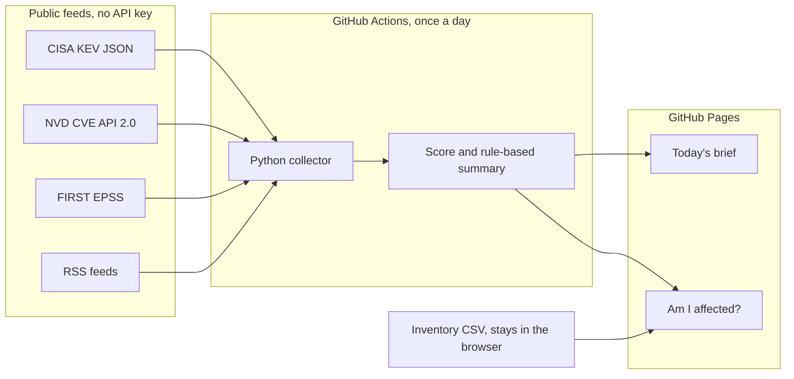

# AI-Cybersecurity Assistant v2.5 (Enterprise Work Edition)

An enterprise-ready, AI-powered network security auditor, OSINT intelligence platform, and attack surface monitoring suite designed for security engineers, penetration testers, and SOC analysts. It combines `nmap` reconnaissance, deep HTTP security posture checks, subdomain mapping, multi-source OSINT (DNS, Whois, GeoIP, SSL/TLS), and Google Gemini AI to produce structured threat assessments, automated hardening scripts, and client-ready audit reports.

---

## 🚀 Key Features

- **Enterprise Scan Engine & Target Normalization**:
  - **First-Class Domain Name & URL Support**: Enter domain names (`scanme.nmap.org`), full URLs (`https://example.com/login`), hostnames with custom ports (`example.com:8443`), or raw IPs. Targets are automatically normalized, resolving clean hostnames and extracting custom ports.
  - **Work Scan Profiles**: Fast Recon (`-F`), Deep Service & OS (`-sV -O`), Web App Audit (`http-*`), Full Stealth SYN (`-sS -Pn`), Vulnerability Audit (`--script vuln`), and Full 65,535 Port Sweep (`-p-`).
  - **Custom Port Range Selector**: Specify exact ports or ranges (e.g. `80,443`, `1-1024`, `22,3389,8080`) safely without limitation.
- **Domain Intelligence & DNS Profile Engine**:
  - Automatically resolves IPv4 (`A`), IPv6 (`AAAA`), Canonical aliases (`CNAME`), Mail Servers with priorities (`MX`), Name Servers (`NS`), Text verification records (`TXT`), and Zone Start of Authority (`SOA`).
- **Email Security & Anti-Spoofing Assessment**:
  - Evaluates **SPF** (`v=spf1 ...`) records, identifying strictness (`-all` HardFail, `~all` SoftFail, `?all` Neutral, `+all` Critical Vulnerability).
  - Evaluates **DMARC** (`_dmarc.<domain>`) records, parsing policy (`p=reject`, `p=quarantine`, `p=none`), percentage coverage (`pct=`), and aggregate forensic report mailboxes (`rua=`).
  - Automatically rates domain spoofing exposure (`PROTECTED`, `PARTIALLY PROTECTED`, or `VULNERABLE TO SPOOFING`).
- **Cloud / CDN & Reverse Proxy Detection**:
  - Identifies whether the domain is behind Cloudflare, AWS CloudFront, Akamai, Fastly, Azure Front Door, or Imperva Incapsula via CNAME and HTTP headers.
  - Notifies analysts and Gemini AI whether port scans reflect edge proxy nodes rather than the origin server.
- **Deep SSL/TLS Certificate Audit**:
  - Connects using SNI hostname and extracts Certificate Authority (Issuer), Subject, Subject Alternative Names (SANs), TLS protocol versions, cipher suites, and expiry date with an automated **days remaining** countdown.
- **HTTP Security Headers & Web Posture Audit**:
  - Automatically evaluates HTTP/HTTPS web endpoints on targets for essential security headers: `Strict-Transport-Security` (HSTS), `Content-Security-Policy` (CSP), `X-Frame-Options`, `X-Content-Type-Options`, `Referrer-Policy`, and `Permissions-Policy`.
  - Computes a security rating (Grades A-F) with color-coded pass/fail badges.
  - Flags sensitive banner leaks (`Server`, `X-Powered-By`) and inspects Cookie security flags (`Secure`, `HttpOnly`, `SameSite`).
- **Subdomain Reconnaissance & Attack Surface Mapping**:
  - Maps corporate and infrastructure subdomains (`api`, `dev`, `staging`, `vpn`, `app`, `admin`, `portal`, `auth`, `corp`, `cdn`, `beta`, `sso`, `gitlab`, `jenkins`, `dashboard`, `internal`, `db`, `smtp`, `origin`, `m`, etc.) with resolved IP addresses.
  - 1-click **"Scan Target"** button on discovered subdomains.
- **Automated Remediation & Hardening Script Generator**:
  - Instantly generates production-ready, battle-tested **Bash** (UFW, iptables, sysctl, SSH hardening) or **PowerShell** (NetFirewall rules) hardening scripts tailored specifically to the open ports and vulnerabilities found.
  - 1-click **Copy** and **Download Script** (`.sh` or `.ps1`).
- **Client / Engagement Tagging & Analyst Notes**:
  - Tag scans by organization, project, or audit engagement (e.g. `Acme Corp - Q3`, `Internal Audit`).
  - Add persistent auditor commentary, false positive documentation, or verification notes stored in the database.
  - Quick-search filter by target or client tag in the scan history.
- **Dual Work Interfaces**: 
  - **Modern Cyber Dashboard** (`app.py`): Glassmorphism responsive UI with real-time feedback, Domain Posture cards, Markdown report rendering, interactive chat advisor, and export to PDF/JSON.
  - **Interactive Terminal Console** (`cli.py`): Rich CLI with colored port tables, Domain & DNS profile tables, Email Anti-Spoofing tables, SSL/TLS certificate tables, HTTP audit tables, subdomain tables, and instant domain deep-dive option `[4]`.
- **LAN & Subnet Sweeper**: Discover live hosts across subnets or CIDR ranges (`nmap -sn`) with hardware vendor detection.
- **Continuous Monitoring & Attack Surface Diffing**:
  - Scheduled target monitoring with port change detection.
  - Instant **Discord/Slack Webhook alerts** when changes occur.

---

## 🛠️ Automated Setup in WSL (Recommended)

Because the project is located on your Windows drive (`C:\Users\lawre\Documents\github\Per_projects\AI_Assistant`), it is automatically mounted in WSL Ubuntu at:
```bash
/mnt/c/Users/lawre/Documents/github/Per_projects/AI_Assistant
```

### 1-Click Automated Setup
Inside your WSL terminal, navigate to the folder and run:
```bash
cd /mnt/c/Users/lawre/Documents/github/Per_projects/AI_Assistant
chmod +x setup_wsl.sh
./setup_wsl.sh
```
This automatically:
1. Installs `nmap`, `python3`, `python3-venv`, and system dependencies via `apt-get`.
2. Creates and activates the Linux virtual environment (`.venv_wsl`).
3. Installs all Python dependencies.
4. Executes the automated test suite (`python -m unittest tests/test_suite.py`) to verify everything is working.

---

## 💻 Running the Assistant in WSL

### 🌐 Web Dashboard
```bash
source .venv_wsl/bin/activate
python app.py
```
Open your browser on Windows and navigate to:
👉 **[http://127.0.0.1:5001](http://127.0.0.1:5001)**

### ⌨️ Terminal CLI
```bash
source .venv_wsl/bin/activate
python cli.py
```

---

## 📁 Project Structure

```
AI_Assistant/
├── .env                 # Environment variables (GEMINI_API_KEY)
├── app.py               # Flask web server, REST API, & APScheduler cron jobs
├── cli.py               # Rich interactive command-line interface
├── db.py                # SQLite database management (history, diffs, watchlists)
├── utils.py             # Reconnaissance engine (Nmap, OSINT, AI, Subnet sweeper)
├── templates/
│   └── index.html       # Single-page web dashboard (Tailwind, Marked.js, html2pdf)
├── pyproject.toml       # Project configuration and dependencies
├── threat-brief/        # Separate daily briefing and "Am I affected?" site
└── README.md            # Documentation
```

---

## Security Threat Brief

This is a separate, free tool in `threat-brief/`. It does not change the assistant above, and it does not use the Gemini API.

It builds a daily briefing for small South African businesses from public feeds: the CISA Known Exploited Vulnerabilities catalog, recent High and Critical CVEs from the NVD API 2.0 (no API key), FIRST EPSS scores for that recent set, and three RSS feeds. It removes duplicate CVEs, scores each one, writes a rule-based plain-English summary with a "what to do" line, and publishes a static site. The "Am I affected?" page compares a CSV inventory in the browser. The file is not uploaded.

### What it does not do

- It does not scan a network, a computer, or an inbox, and it cannot see software that is missing from the CSV.
- It does not call a language model. Summaries are templates. The only summariser shipped here is `rules-v1`.
- It is not a certification, an audit, a penetration test, or a POPIA compliance product.
- It is not a feed from the South African government. CISA KEV is a US federal catalog used as a public signal.
- It is not a complete CVE database. The daily job requests only High and Critical CVEs from the last 7 days, because the keyless NVD limit is 5 requests per 30 seconds. Older KEV rows often have no CVSS and no EPSS in this dataset. The score reasons say when a part is missing.
- EPSS is a probability published by FIRST, not a promise that a business will be attacked.
- Version matching is approximate. Names are matched loosely, version ranges are a capped flat list of CPE matches, and NVD's AND/OR configuration trees are not evaluated. Many KEV entries have no version.
- The small-business software list (Microsoft 365/Exchange, Windows, WordPress, Fortinet, MikroTik, TP-Link, card machines) is a configurable starting point in `threat-brief/config/smb_software.json`, not a census.
- News headlines are copied from third parties and are not fact-checked.

### Score

Formula `smb-sa-v1`, out of 100. Defaults in `threat-brief/config/settings.json`: CVSS up to 40 (`score / 10 × 40`), KEV 25 or 0, EPSS up to 20 (`probability × 20`), small-business software 15 or 0. Each part is rounded to one decimal and the total is capped at 100. The reasons are stored with the number. News uses a separate relevance score capped at 20. "Patch soon" and "Check this week" are reading labels, not extra points. A known-exploited item is labelled "Patch soon" even when CVSS is missing.

### Architecture



### Run it locally

No extra Python packages.

```bash
python3 -m unittest discover -s threat-brief/tests -v
node threat-brief/tests/match.test.mjs
python3 threat-brief/collect.py --fixtures
python3 threat-brief/collect.py
cd threat-brief/site && python3 -m http.server 8765
```

`--fixtures` uses the recorded samples and does not touch the network. Then open `http://127.0.0.1:8765/` and `http://127.0.0.1:8765/affected.html`. Use **Load the sample inventory** for the demo. More detail is in `threat-brief/README.md`.

### Enable Pages

The workflow is `.github/workflows/threat-brief.yml`. It runs daily at 04:15 UTC and from the Actions tab. It does not run on every push. Before the first run, the owner needs to:

1. Open **Settings → Pages → Build and deployment** and set **Source** to **GitHub Actions**. Save.
2. Open **Settings → Actions → General → Workflow permissions** and select **Read and write permissions**. Save.
3. Open **Actions → Threat brief → Run workflow**.
4. If GitHub asks for approval to deploy to the `github-pages` environment, approve it.

After a successful deploy, the Pages settings show the site URL. For this public repository that is expected to be `https://lawrence-flash.github.io/AI_Assistant/`. If branch protection blocks `github-actions[bot]` from pushing to `main`, the data commit will fail until that push is allowed.