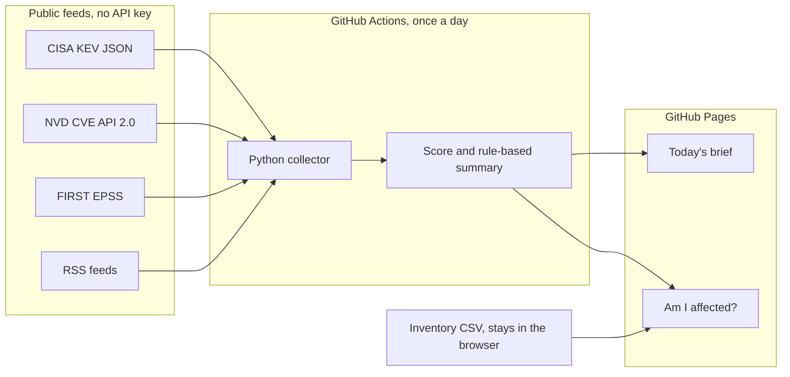

# Security Threat Brief

A small, separate tool for the portfolio. It builds a daily briefing for small South African businesses from public feeds, and it includes a browser-only "Am I affected?" check.

It does not change the existing assistant in `app.py`.

## What it does

- Downloads the CISA Known Exploited Vulnerabilities JSON catalog.
- Downloads recent **High** and **Critical** CVEs from the NVD CVE API 2.0, without an API key.
- Downloads FIRST EPSS scores for that recent set (recent NVD CVEs, plus KEV entries added in the last 30 days).
- Downloads three configurable RSS feeds.
- Drops duplicate CVEs, attaches a news link to a CVE when the headline names it, and writes `site/data/brief.json` and `site/data/catalog.json`.
- Scores each CVE with the formula in `config/settings.json` and writes the reasons next to the number.
- Writes a rule-based plain-English summary and one "what to do" line. No language model.
- Publishes a static site: today's brief, with filters, and an inventory check that runs in the browser.

## What it does not do

- It does not scan a network, a laptop, a website, or an inbox.
- It does not call Gemini, Google Cloud, or any paid API. There is no API key.
- It does not know which South African business is affected until someone loads a CSV, and that CSV never leaves the browser.
- It is not a certification, an audit, a penetration test, or a POPIA compliance tool.
- It is not published by CISA, NIST, FIRST, or the South African government. KEV is a US federal catalog. It is a useful signal, not a local mandate.
- It is not a complete CVE database. Without an NVD API key the daily job only requests High and Critical CVEs from the last 7 days, then waits between requests. Older KEV rows often have no CVSS and no EPSS in this dataset, and the reasons say so.
- EPSS is a probability from FIRST. It is not a prediction that a specific business will be attacked.
- Version matching is approximate. It does not evaluate NVD's AND/OR configuration trees. Many KEV rows have no version at all.
- News items are third-party headlines. They are not checked for accuracy.
- The software list in `config/smb_software.json` is a starting point (Microsoft 365/Exchange, Windows, WordPress, Fortinet, MikroTik, TP-Link, card machines). It is editable. It is not a census of South African software.
- Summaries are template sentences. An AI summariser is not included. `get_summariser()` will refuse any engine other than `rules-v1`.

## How the score works

Formula id `smb-sa-v1`, out of 100. The weights below are the defaults. The site prints the formula that was stored with the data file.

| Part | Default | Rule |
| --- | --- | --- |
| CVSS | 40 | `(base score / 10) × 40`. Prefer CVSS 4.0, then 3.1, then 3.0, then 2.0. Missing score = 0. |
| KEV | 25 | 25 if the CVE is in the CISA catalog, otherwise 0. Ransomware is mentioned and does not add points. |
| EPSS | 20 | `probability × 20`. Missing score = 0. |
| Small-business software | 15 | 15 if the vendor or product matches `config/smb_software.json`, otherwise 0. |

Each part is rounded to one decimal, then added. The total is capped at 100. Every part, including a zero, is listed in "Why this score".

News does not use this formula. A headline can score up to 10 for a software-list mention and 10 for words such as ransomware or zero-day. That cap is 20, so a headline stays below a serious CVE.

The labels "Patch soon", "Check this week", and "Lower on this list" are only there to make the page easier to read. They do not add points. A known-exploited item is labelled "Patch soon" even when CVSS is missing, because the catalog already says attackers are using it.

## Architecture



`collector/summarise.py` is the only place a future summary engine would plug in. This version registers `rules-v1` only.

## Run it locally

From the repository root. Python 3.11 or newer. No packages to install.

```bash
python3 -m unittest discover -s threat-brief/tests -v
node threat-brief/tests/match.test.mjs
python3 threat-brief/collect.py --fixtures
python3 threat-brief/collect.py
```

`--fixtures` rebuilds the JSON from the recorded samples and does not use the network. The live command respects NVD's keyless limit by requesting only two severity slices and waiting 6 seconds between NVD calls. On 403, 429, or 503 it waits and retries, then gives up. If every vulnerability feed fails, it leaves the existing JSON files alone.

Preview the site with a local server. Opening the HTML file directly often blocks `fetch` of the JSON.

```bash
cd threat-brief/site
python3 -m http.server 8765
```

Open `http://127.0.0.1:8765/` and `http://127.0.0.1:8765/affected.html`. On "Am I affected?", use **Load the sample inventory**. The sample CSV is `site/sample-inventory.csv`.

## GitHub Pages and the daily job

The workflow file is `.github/workflows/threat-brief.yml`. It runs at 04:15 UTC and when someone starts it by hand. It does not run on every push. It uses the Python already on the runner, commits `brief.json` and `catalog.json` if they changed, and deploys `threat-brief/site`.

The repository owner has to turn two switches on or the job cannot publish:

1. **Settings → Pages → Build and deployment → Source: GitHub Actions**, then Save.
2. **Settings → Actions → General → Workflow permissions → Read and write permissions**, then Save.

Then **Actions → Threat brief → Run workflow**. If GitHub asks for approval to use the `github-pages` environment, approve it.

The site will be at `https://lawrence-flash.github.io/AI_Assistant/`.

If `main` is protected and rejects pushes from `github-actions[bot]`, the data commit fails until that bot is allowed to push. This repository is public, so GitHub Pages is available on the free plan.
